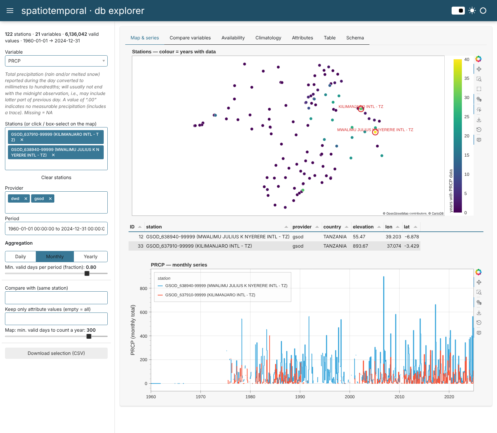

# HoloViz explorer for the `spatiotemporal` db

A [Panel](https://panel.holoviz.org) / HoloViews / hvPlot web app to browse a
`spatiotemporal` database (`data(db)`, or any `.rds` with the same schema such as
`inst/shiny/gsodapp/ext/db_icpac_v2.rds`).



Tabs:

| Tab | What it shows |
|---|---|
| **Map & series** | stations on a CartoDB basemap, coloured by number of years with data for the chosen variable; click (toggle) or box-select stations; daily / monthly / yearly series |
| **Compare variables** | the chosen variable plus others (e.g. PRCP + MAX + MIN) for the same stations, shared time axis |
| **Availability** | heat-map station × year of valid days (all stations of the selected providers, or only the selected ones) |
| **Climatology** | mean annual cycle per station + box-plots of monthly values |
| **Attributes** | `attrvalue` counts per station and per year (e.g. GSOD PRCP flags A–I, number of obs for TEMP) |
| **Table** | the current selection in long format, with header filters; CSV download in the sidebar |
| **Schema** | tables, columns, types and foreign keys (`<table>_id` → `<table>$ID`), same rule as the README nomnoml diagram |

Aggregation: `PRCP`, any variable whose name contains *prec*/*rain*, and the `I_*`
indicators are **summed**, all others **averaged**. A period is set to `NA` when its
fraction of valid days is below the *Min. valid days* slider (default 0.8).

## Install & run

```bash
cd inst/holoviz
pip install -r requirements.txt

# first run converts data/db.rda -> data/db_parquet/ (~2 min, pure-Python R reader),
# later runs load the Parquet cache in ~1 s
panel serve app.py --show

# another database
panel serve app.py --show --args --data ../shiny/gsodapp/ext/db_icpac_v2.rds
STDB_DATA=/path/to/db_parquet panel serve app.py --show
```

The Parquet cache can also be written from R, which is much faster
(needs `arrow`):

```bash
Rscript export_db_parquet.R ../shiny/gsodapp/ext/db_icpac_v2.rds ../shiny/gsodapp/ext/db_icpac_v2_parquet
```

## Files

- `stdb.py` – Python access layer: `load()`, `convert()` and R-like
  `get_p()` / `get_ts()` getters on a `SpatioTemporalDB` object.
- `app.py` – the Panel app.
- `export_db_parquet.R` – optional R exporter to the same Parquet layout
  (one file per table; `p` gets `lon`/`lat` instead of the sf geometry).

```python
import stdb
db = stdb.load("../../data/db.rda")
prcp = db.get_ts(p_id=[12], variable_id=[11], start="1990-01-01")
```

Behind a reverse proxy or another host/port (e.g. RStudio Server proxy on
`rendena103.cloud:8787`), allow that browser origin:

```bash
panel serve app.py --port 5006 --allow-websocket-origin=rendena103.cloud:8787
# or: export BOKEH_ALLOW_WS_ORIGIN=rendena103.cloud:8787
```

Set `STDB_DYNAMIC=1` to render tabs lazily (lighter server, but with some
Panel/Bokeh versions hidden tabs come up empty — default is off).
